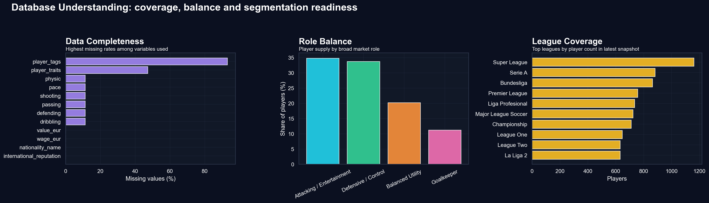
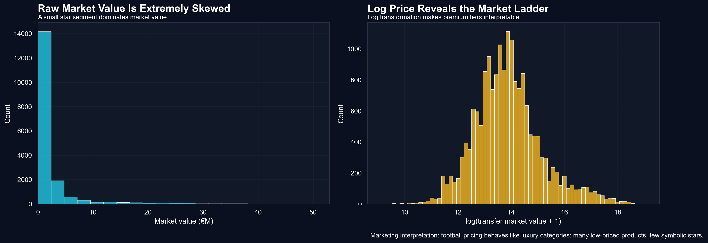
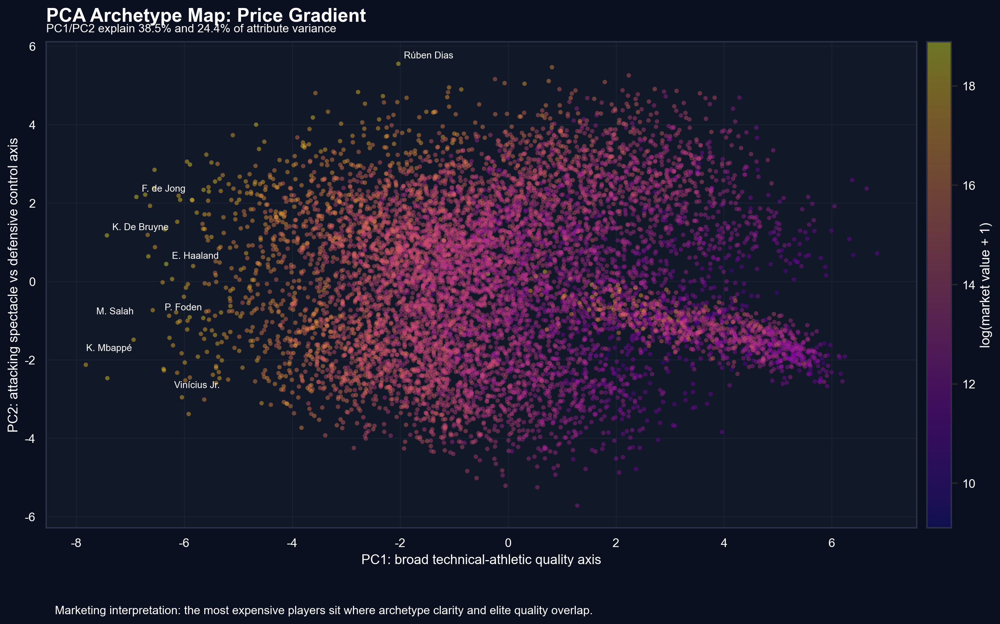
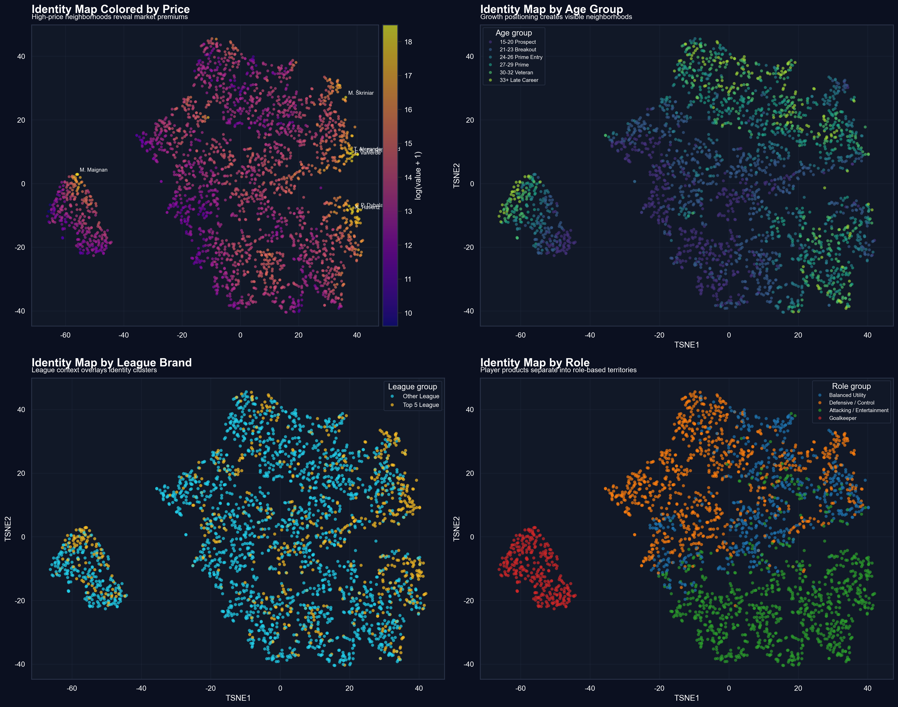
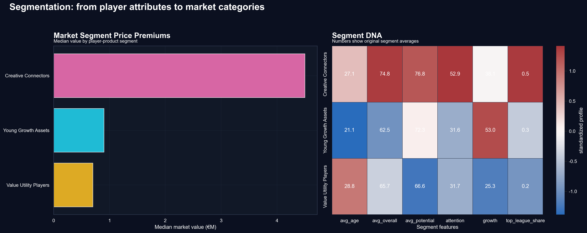
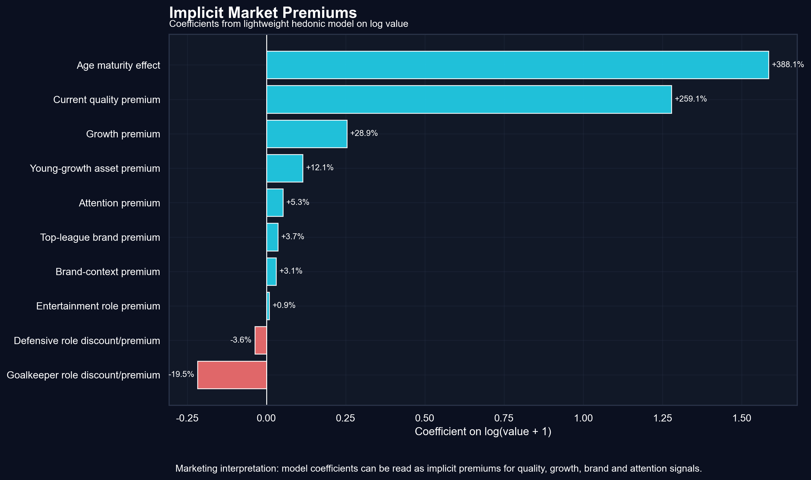
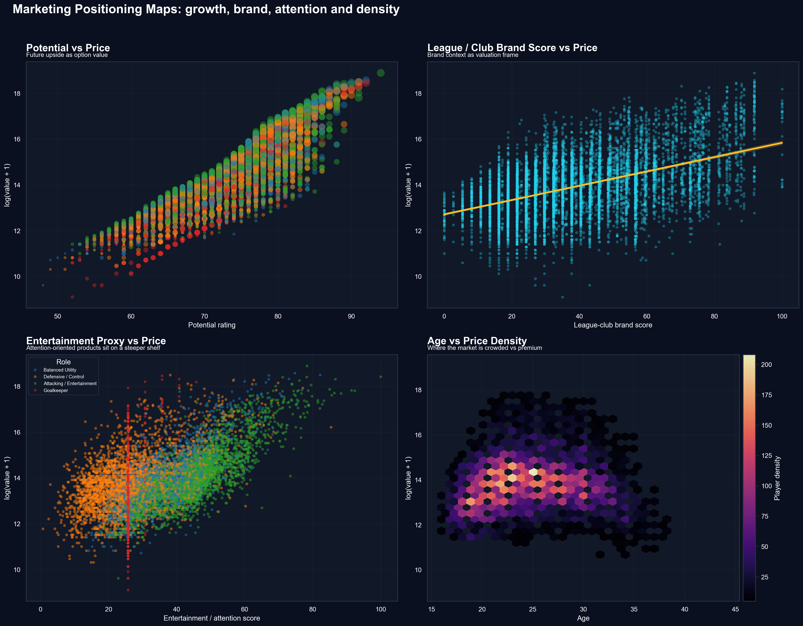
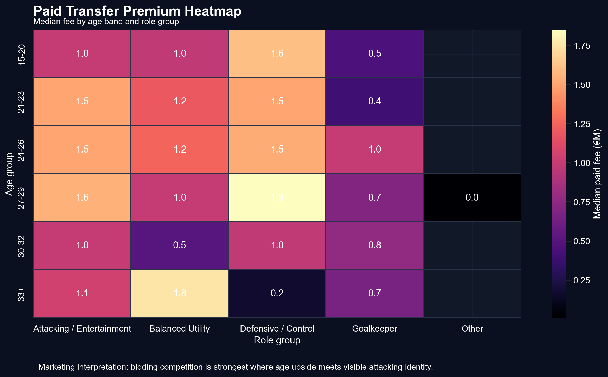

# 足球转会市场定价机制研究 Proposal

## 一、研究目标

本研究的核心问题是：**足球俱乐部如何通过转会支出揭示其市场偏好？**

具体研究目标包括：
1. 识别影响转会定价的关键因素（年龄、潜力、技术属性、联赛品牌）
2. 量化不同类型球员的市场溢价（成长溢价、品牌溢价、注意力溢价）
3. 数据可视化展示球员市场的细分结构与定位逻辑
4. 从实际角度，使用营销方面知识解读转会费作为"显示性偏好"的原因

## 二、数据来源与描述

### 数据集

**1. FIFA 球员数据库** (`male_players.csv`)
- 约 560 万条记录，包含多个 FIFA 版本的历史快照
- 关键变量：年龄、位置、综合评分 (overall)、潜力评分 (potential)、市场价值 (value_eur)、技术属性（pace, shooting, passing, dribbling, defending, physic）、联赛、俱乐部、国际声誉、技术动作等级

**2. 转会市场交易数据** (`Transfer Market Data.csv`)
- 约 47 万条真实转会记录
- 关键变量：球员姓名、年龄、位置、转会费 (cost)、转出/转入俱乐部、联赛、转会日期

**3. 俱乐部数据** (`male_teams.csv`)
- 约 11 万条记录
- 关键变量：俱乐部名称、联赛、整体评分、国际/国内声望、转会预算、俱乐部价值

### 特征工程

基于原始数据构建的衍生变量：
- **潜力差 (potential_gap)**: potential - overall，衡量成长空间
- **年龄组**: 青年球员 (<23)、黄金年龄 (23-29)、老将 (30+)
- **角色分组**: 进攻型、中场型、防守型、门将
- **顶级联赛标识**: 是否五大联赛
- **娱乐性得分 (attention_score)**: pace + dribbling + shooting + skill_moves 的加权组合
- **品牌得分 (brand_score)**: 联赛等级 + 俱乐部声望的综合指标

### 数据充分性

数据集涵盖球员属性、市场背景、真实交易价格等多维度信息，样本量充足（数十万级别），足以支持统计分析和可视化研究。主要局限是部分变量存在 15-30% 缺失值，需通过数据清洗处理。


*图1: 数据集基本信息与变量分布*


*图2: 转会费呈现高度右偏分布，少数明星球员占据高价区间*

## 三、研究方法

### 3.1 探索性数据分析

通过描述性统计和可视化理解数据分布特征：
- 转会费分布（直方图、密度图）
- 年龄-价格关系（散点图、回归线）
- 联赛-价格比较（箱线图、小提琴图）
- 位置-价格差异（分组统计）

### 3.2 市场细分与定位分析

**主成分分析 (PCA)**
- 输入：六大技术属性（pace, shooting, passing, dribbling, defending, physic）
- 输出：2-3 个主成分，代表球员核心技术原型
- 可视化：PCA 散点图，用颜色编码价格、位置、联赛


*图3: 主成分分析揭示球员技术原型与价格梯度*

**t-SNE 降维可视化**
- 展示球员在高维属性空间中的"身份邻域"
- 用颜色编码价格、年龄组、联赛、位置


*图4: t-SNE 展示相似球员形成的市场邻域*

**K-Means 聚类分析**
- 将球员划分为 5-7 个市场细分
- 预期细分类型：年轻成长型资产、精英娱乐型球员、防守专家、创造型中场、实用型老将等


*图5: 球员市场细分与各细分的特征轮廓*

### 3.3 溢价因素量化

**Hedonic Pricing Model（特征价格模型）**

模型设定：
```
log(value_eur + 1) = β₀ + β₁·overall + β₂·potential_gap + β₃·age 
                     + β₄·is_top_league + β₅·club_prestige 
                     + β₆·attention_score + ε
```

通过回归分析量化各因素对价格的边际贡献：
- **成长溢价**: potential_gap 系数
- **品牌溢价**: is_top_league, club_prestige 系数
- **注意力溢价**: attention_score 系数
- **质量溢价**: overall 系数


*图6: 各因素对转会定价的贡献度*

### 3.4 综合定位图谱

构建多维定位图展示市场结构：
- 年龄-潜力-价格三维图
- 联赛-角色定价热力图
- 成长溢价 vs 品牌溢价散点图


*图7: 综合定位图展示不同球员类型的市场位置*


*图8: 联赛与角色的定价热力图*

## 四、预期结论

本研究预期发现：

1. **成长溢价显著**：年轻高潜力球员（potential_gap 大）会有显著价格溢价，因为市场在为其未来成长支付额外费用

2. **品牌效应明显**：顶级联赛球员相比低级别联赛享有品牌溢价，俱乐部愿意花更多钱买出身优秀的球员

3. **注意力经济**：进攻型、高技术动作、高速度的"娱乐型"球员获得注意力溢价，说明观感更加精彩的球员会提升自己价值

4. **市场细分定价**：不同大类球员面临不同的竞争格局与定价逻辑，市场并非从单一视角维度评价球员
