# 足球转会市场的网络与地理分析研究 Proposal

## 一、研究目标

本研究关注的问题是：**足球俱乐部如何通过转会支出揭示市场偏好？从网络与地理视角分析全球足球人才流动。**

具体目标包括：第一，揭示全球转会市场是否呈现中心-边缘结构；第二，识别关键转会枢纽，包括俱乐部、联赛和国家；第三，可视化跨国、跨联赛的人才流动路径；第四，分析地理距离、联赛品牌与转会定价之间的关系；第五，通过球员标签文本识别高价球员的常见特征。

## 二、数据来源与描述

本研究使用三个数据集。`Transfer Market Data.csv` 包含 19,139 条转会记录，其中 1,326 条为 `cost > 0` 的实际付费转会；字段覆盖转出/转入俱乐部、联赛、国家、转会费、球员市场估值、转会日期以及经纬度坐标，因此适合构建流向网络与地理距离分析。

`male_players.csv` 提供球员能力、潜力、市场价值、技术属性、球员标签与特质等信息；考虑到文件较大，Notebook 只分块读取最新 FIFA 快照并缓存。`male_teams.csv` 提供俱乐部能力、声望、预算和俱乐部价值等信息，用于补充市场背景。

## 三、研究方法

### 3.1 网络分析

#### 俱乐部转会网络

将俱乐部设为节点，将付费转会设为有向边，边方向为“转出俱乐部 → 转入俱乐部”，边权重为转会次数和转会费总额。核心指标包括度中心性、入度、出度、中介中心性与 PageRank，用于区分活跃交易者、买家俱乐部、卖家俱乐部和市场影响力节点。

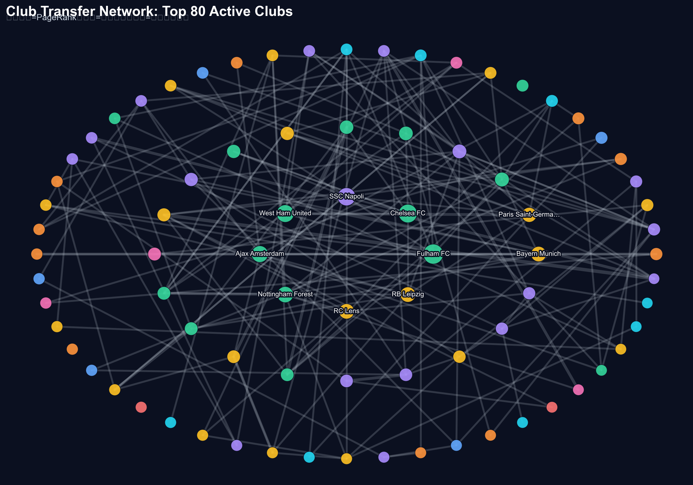
*图1：俱乐部转会网络图。节点大小表示 PageRank，颜色表示主要联赛，边宽表示付费转会次数。*

图中可以看到付费转会网络较分散，但头部俱乐部形成明显的高连接核心。样本中俱乐部网络包含 881 个节点和 1,282 条边，说明市场不是少数俱乐部之间的封闭交易，而是由多个局部枢纽连接起来。

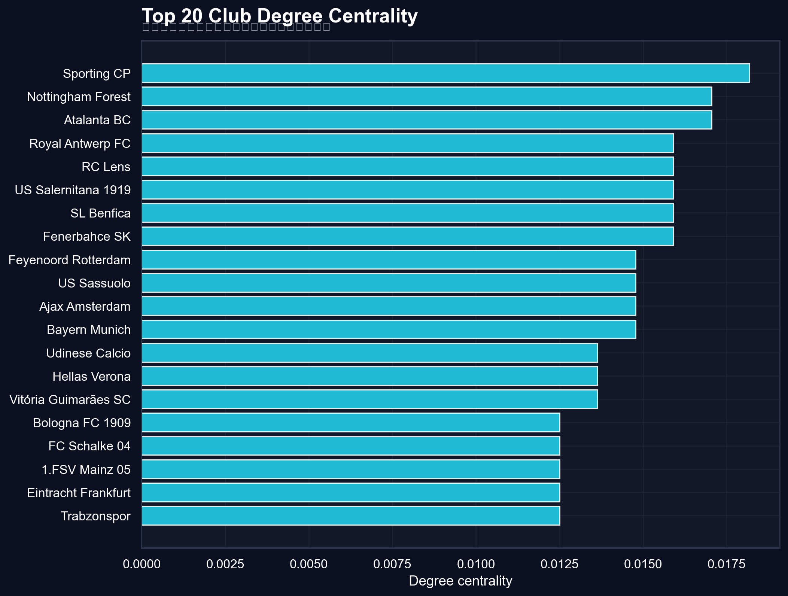
*图2：Top 20 俱乐部的度中心性排名。*

Sporting CP 的度中心性最高，说明其买入和卖出连接都较广；Nottingham Forest 在入度上特别突出，更接近强买方节点；AS Roma 的出度最高，更像活跃输出节点。

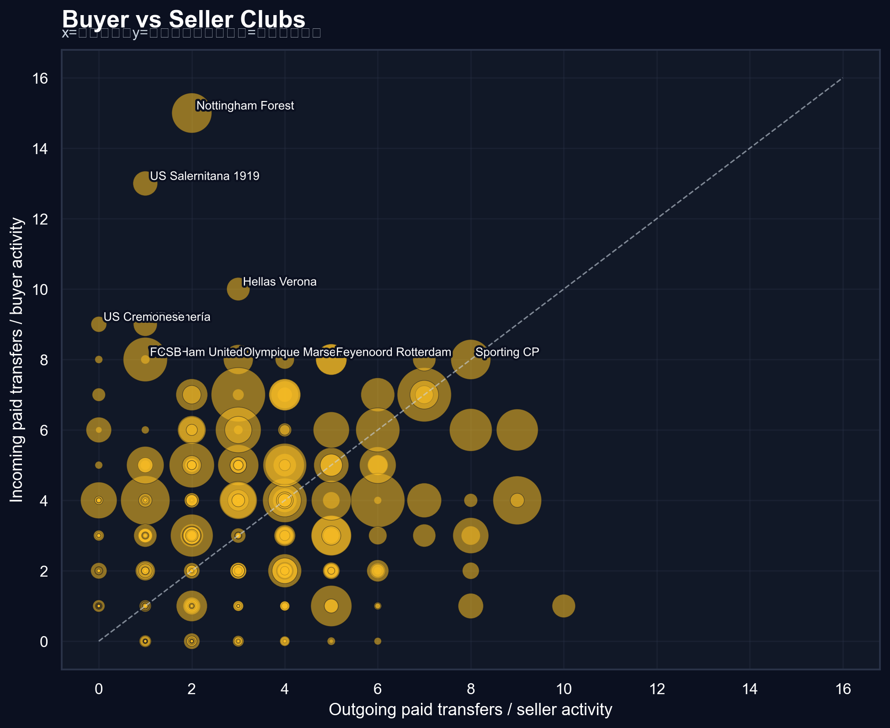
*图3：买家 vs 卖家俱乐部散点图。x 轴为转出次数，y 轴为转入次数，气泡大小表示相关转会总额。*

散点图把俱乐部分为三类：靠近对角线的是双向活跃俱乐部，y 轴较高的是买方俱乐部，x 轴较高的是卖方俱乐部。这个划分能帮助解释俱乐部战略差异：有的俱乐部依靠买入补强，有的俱乐部更像人才交易和培养平台。

#### 联赛间流动网络

联赛层面把同一联赛内俱乐部合并为节点，边表示联赛之间的付费转会流动。该部分重点比较人才输出联赛与人才吸引联赛，并计算“流入 - 流出”的转会平衡。

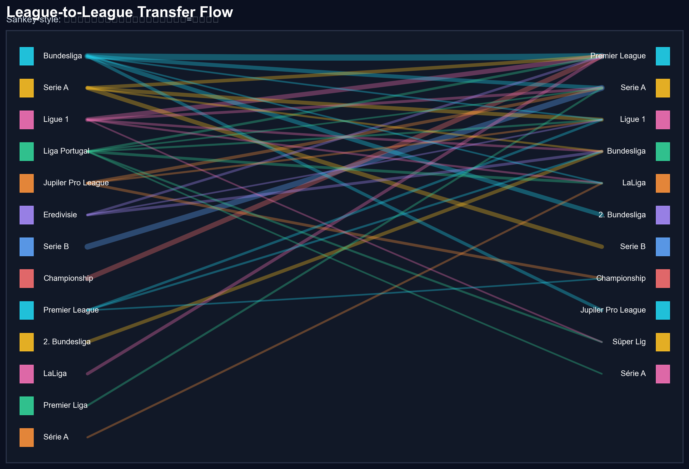
*图4：联赛间转会流动 Sankey-style 图。左侧为输出联赛，右侧为输入联赛，线宽表示转会次数。*

联赛之间的流动显示，五大联赛既互相交易，也从葡超、荷甲、巴甲等联赛吸收球员。流向集中在少数高品牌联赛，符合“中心联赛吸收边缘/半边缘联赛人才”的市场结构。

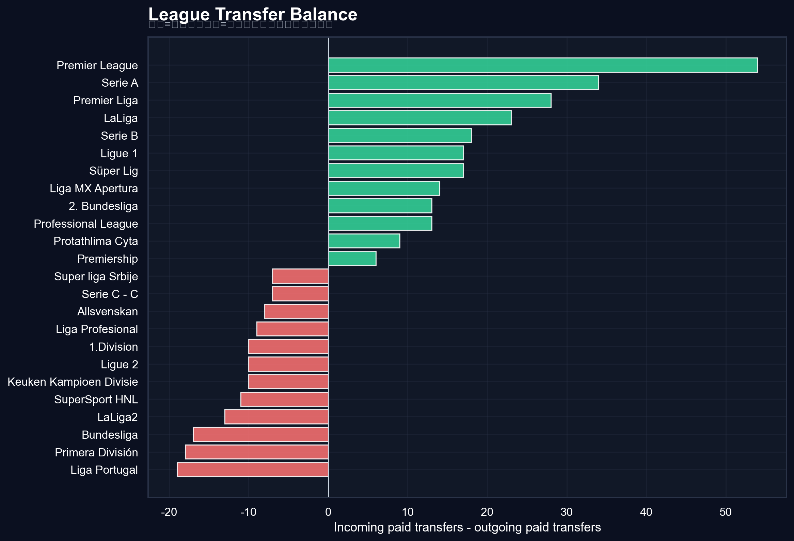
*图5：联赛转会平衡。正值表示净流入，负值表示净流出。*

Premier League 是样本中最明显的净流入联赛，净流入 54 笔付费转会；Liga Portugal 是主要净流出联赛之一。这个结果支持“英超作为需求中心、葡超作为跳板联赛”的预期判断。

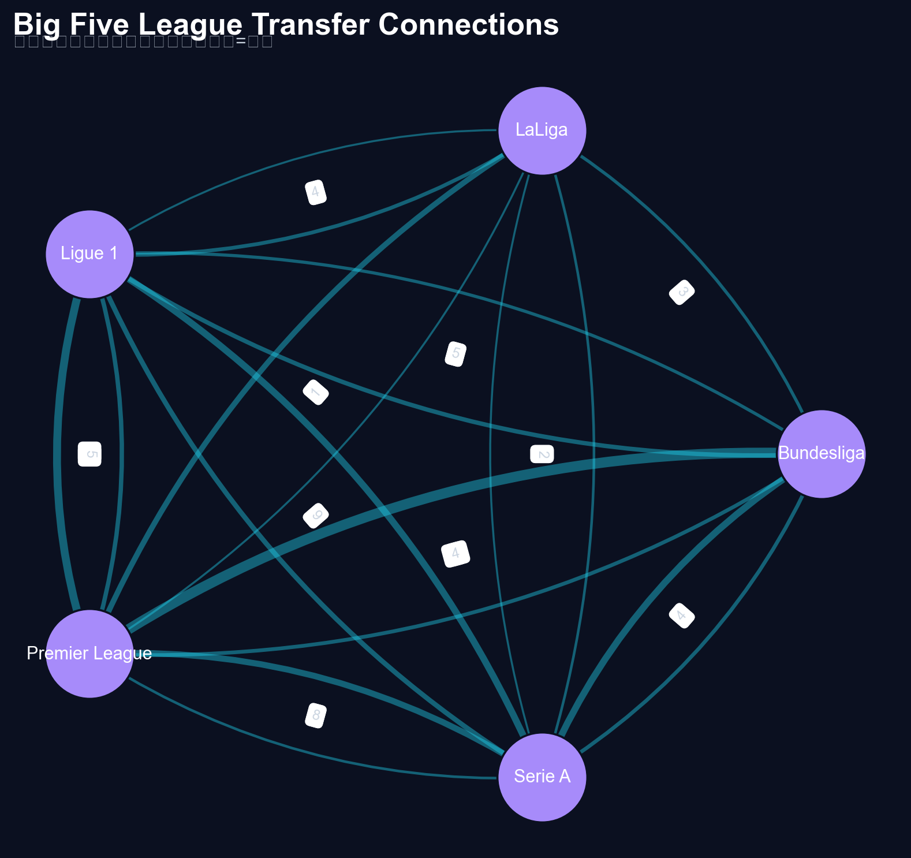
*图6：五大联赛之间的付费转会网络。边宽表示转会次数。*

五大联赛内部存在高频互联，但不是完全对称。Premier League 的 PageRank 最高，说明它不仅交易频繁，而且接收来自高质量联赛节点的流入。

#### 国家转会网络

国家层面网络把转出国家与转入国家设为节点，边表示跨国家的人才流动。该视角用于观察全球足球人才是否呈现“欧洲中心、南美/非洲输出”的模式。

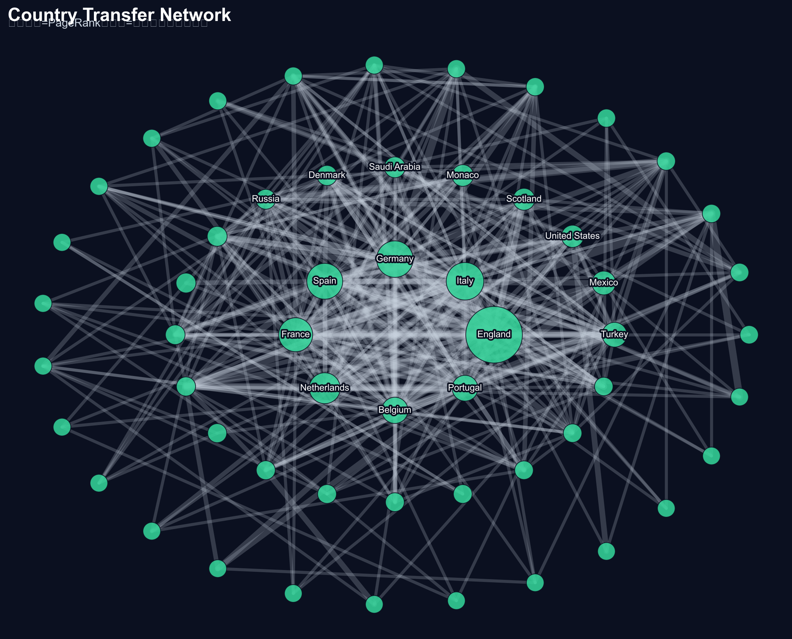
*图7：国家转会网络图。节点大小表示 PageRank，边宽表示国家间付费转会次数。*

国家网络显示欧洲国家处于高连接位置，英格兰、意大利、德国、法国、西班牙等国家在流入端更重要。南美国家更多表现为通向欧洲的外部供给节点。

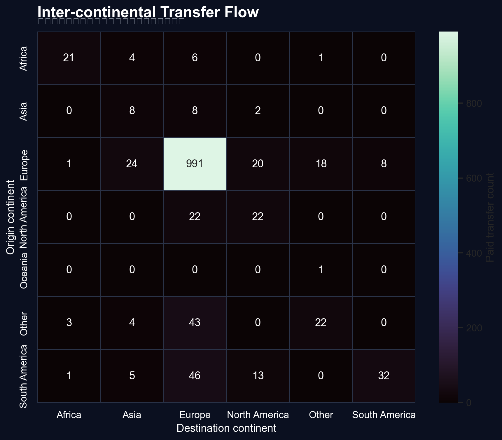
*图8：洲际转会流动热力图。数值表示付费转会次数。*

欧洲内部转会数量最多，说明欧洲市场具有高度内部循环特征。南美到欧洲的路径虽然数量少于欧洲内部，但中位转会费更高，是重要的高价值跨区域路径。

### 3.2 地理数据可视化

#### 全球转会流动

使用转出地和转入地经纬度绘制全球转会流向。由于研究需要稳定离线复现，地图采用经纬度坐标系和弧线表示流向，不依赖在线底图。

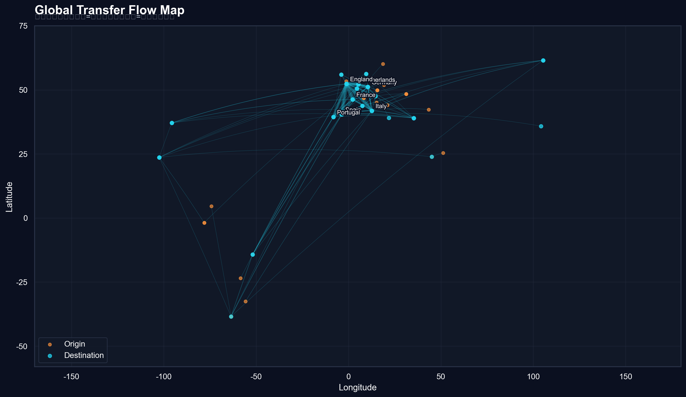
*图9：全球转会流动地图。线条表示国家间转会路径，线宽表示转会费总额。*

全球流动图进一步显示欧洲是最密集的目的地区域，同时存在从南美到欧洲、欧洲内部、北美与欧洲之间的多条路径。高额路径并不均匀分布，而是集中在少数足球强国之间。

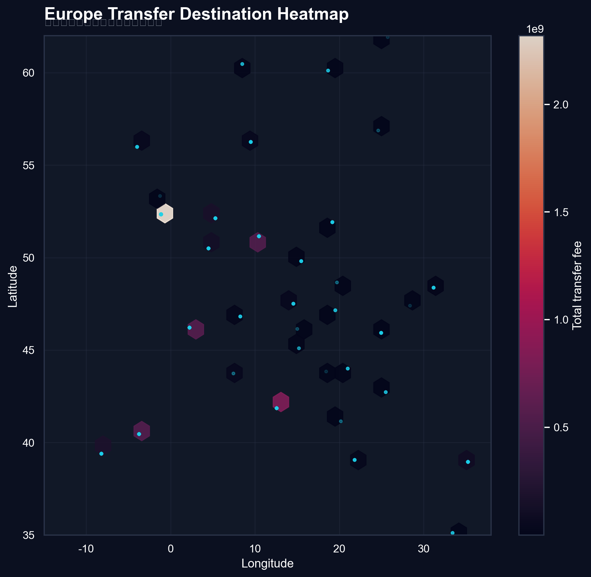
*图10：欧洲转入地热力图。颜色越亮表示该区域付费转会费总额越高。*

欧洲热力图显示转入目的地高度集中在西欧主要足球市场。英格兰、意大利、西班牙、德国和法国附近的密度明显更高，反映联赛品牌和资本能力对人才吸引的作用。

#### 地理距离与转会费

基于 Haversine 公式计算转出地与转入地之间的地理距离，并比较距离与转会费的关系。同时比较国内转会和跨国转会的价格分布。

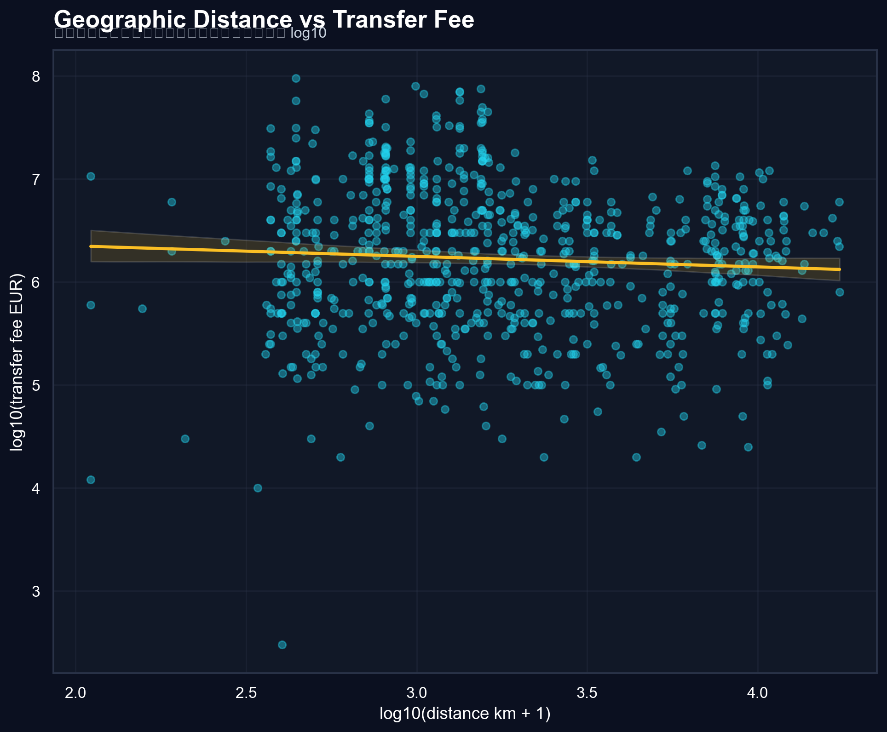
*图11：地理距离与转会费的关系。横轴为 log10 距离，纵轴为 log10 转会费。*

距离与转会费的相关系数约为 -0.065，线性关系较弱。这说明“距离本身”不是主要定价因素，路径背后的联赛品牌、球员稀缺性和买方支付能力可能更关键。

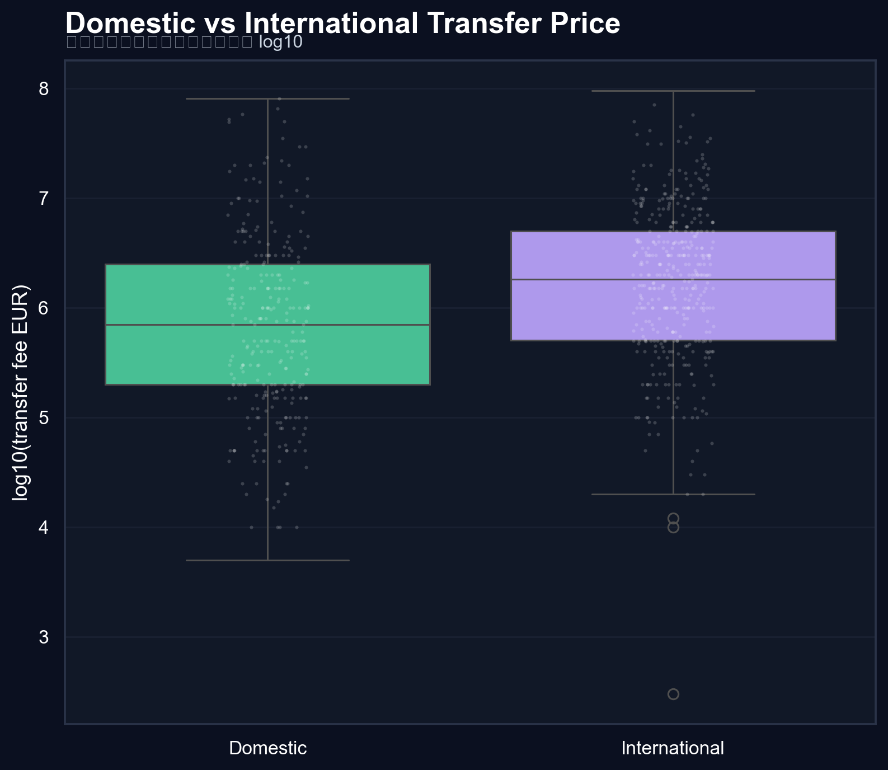
*图12：国内转会 vs 跨国转会的价格分布。纵轴为 log10 转会费。*

跨国转会的中位费用为 182 万欧元，高于国内转会的 70 万欧元。该差异支持“跨市场购买通常意味着更强筛选和更高支付意愿”的解释。

#### 区域转会特征

将转会路径按洲际组合分组，比较不同区域路径的样本数量和中位费用。

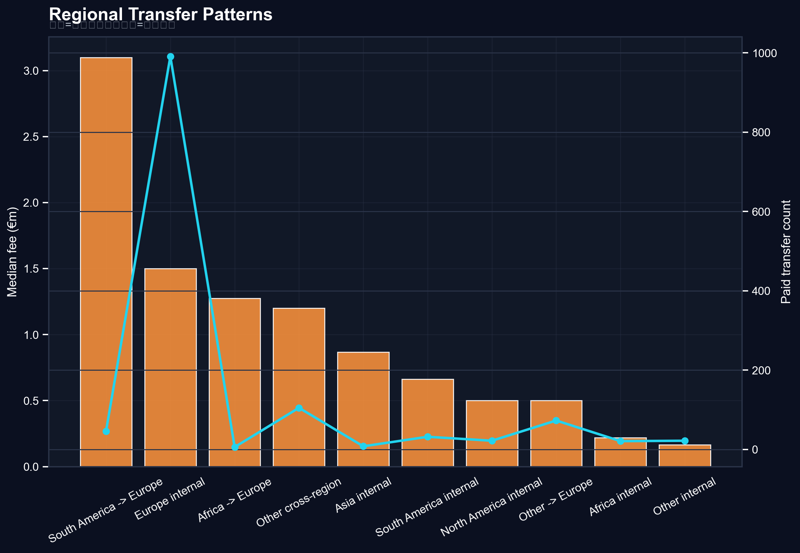
*图13：不同区域转会路径的中位费用与转会次数对比。*

欧洲内部转会数量最多，但南美到欧洲的中位费用达到 310 万欧元，比欧洲内部路径高约 106.7%。这说明南美到欧洲虽然不是最大流量路径，却是高价值人才采购路径。

### 3.3 文本分析

#### 球员标签

将付费转会球员姓名与最新 FIFA 球员快照中的 `short_name`、`long_name` 进行标准化匹配，再提取 `player_tags`。由于两个数据源并非完全同源，成功匹配到标签的付费转会为 85 条，因此文本分析作为轻量级补充证据。

*图14：高价球员标签词云。样本为转会费 top 10% 且成功匹配到标签的球员。*

高价球员常见标签包括 Acrobat、Strength、Engine、Dribbler 和 Speedster。标签集中在身体、速度、盘带和进攻表现，说明高价交易不仅购买位置需求，也购买更容易被市场感知的能力符号。

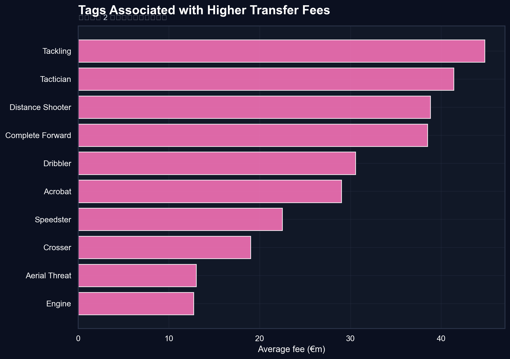
*图15：不同球员标签对应的平均转会费。*

标签与价格关系图显示，部分进攻型、技术型和身体优势标签对应更高平均转会费。由于文本匹配样本较小，该结论适合作为探索性发现，而不是严格因果结论。

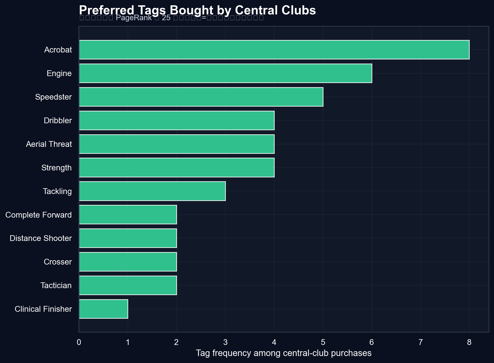
*图16：网络中心俱乐部购买球员的常见标签。*

PageRank 前 25 的中心俱乐部更频繁购买带有速度、技术、身体或进攻标签的球员。换言之，网络中心位置较高的俱乐部，不只是在市场中更活跃，也更倾向于购买可识别、可传播的高价值球员特征。

### 3.4 综合分析

#### 网络位置与定价

综合部分把联赛网络中心性与转入转会费结合，检验中心联赛是否对应更高平均购买价格。

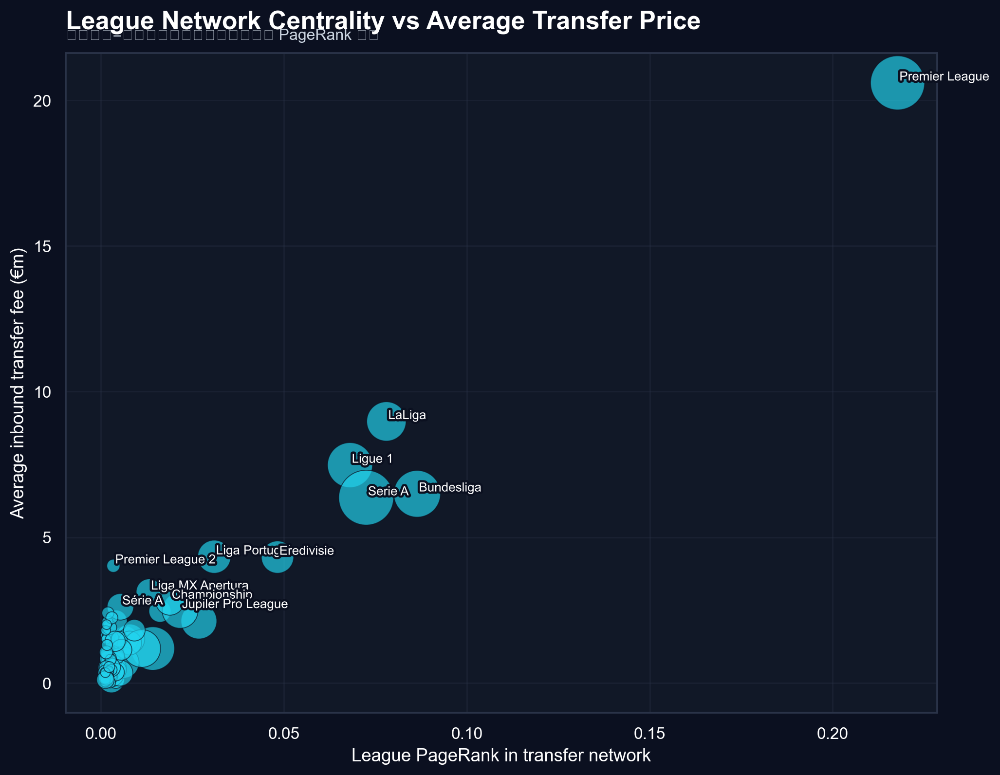
*图17：联赛网络中心性与平均转会费的关系。气泡大小表示转入付费转会数量。*

Premier League 的联赛 PageRank 最高，且净流入最强，说明它同时具备网络中心地位和资本吸引力。中心联赛的高均价并不只是竞技水平结果，也体现了联赛品牌和全球关注度的溢价。

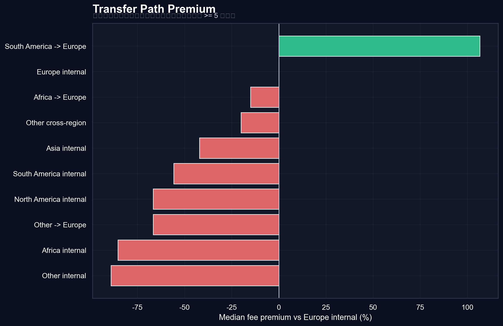
*图18：不同转会路径相对欧洲内部转会的中位价格溢价。*

南美到欧洲路径的中位价格相对欧洲内部转会高约 106.7%。相比之下，非洲到欧洲和其他到欧洲路径没有表现出同等溢价，说明跨洲际溢价并非由距离自动产生，而是由特定人才供给地、球员声誉和欧洲买方需求共同形成。

## 四、预期结论

1. 全球足球转会市场呈现明显中心-边缘结构，Premier League、Serie A、LaLiga、Bundesliga 和 Ligue 1 构成核心吸收区，其中 Premier League 的网络中心性和净流入最突出。
2. 葡超、荷甲等联赛具有跳板市场特征，既连接外部人才来源，也向更高品牌联赛输出球员。
3. 地理距离本身与转会费关系较弱，但跨国转会显著高于国内转会，说明定价更多来自联赛品牌、买方能力和路径选择。
4. 南美到欧洲路径体现出明显价格溢价，是高价值人才流入欧洲的重要通道。
5. 高价球员标签更集中于速度、身体、盘带和进攻相关特征；网络中心俱乐部更倾向购买这些具备市场可见度的球员属性。

## 五、输出与复现

完整分析代码保存在 `transfer_network_geo_analysis.ipynb`，图表保存在 `charts/` 目录。为处理大文件，Notebook 对 `male_players.csv` 与 `male_teams.csv` 采用分块读取最新快照并缓存到 `.cache/`；核心分析只使用 `cost > 0` 的 1,326 条付费转会记录。
