# 足球转会定价中的市场偏好：俱乐部如何通过价格表达定位选择

## 汇报定位

本汇报不是传统体育数据分析，也不是单纯预测球员身价。

我们把足球运动员视为一种高度差异化的市场资产，把转会价格视为营销组合 4P 中最直接的 **Price 信号**。当俱乐部愿意为某类球员支付更高价格时，本质上是在表达它对某种市场定位的偏好。

本次研究的核心问题是：

> **How do football clubs reveal market preferences through transfer spending?**  
> 足球俱乐部如何通过转会支出揭示市场偏好？

---

## 1. 研究框架：从球员能力到市场定位

本汇报使用三个营销理论视角：

第一，**STP 框架**。球员市场不是一个整体市场，而是可以按年龄、位置、联赛、能力结构和商业吸引力进行细分。不同俱乐部会根据自身战略和预算选择目标细分，并通过购买行为完成定位。

第二，**4P 中的 Price**。在转会市场中，价格不是被动结果，而是俱乐部偏好的显性表达。高价意味着俱乐部认为该球员具备稀缺性、未来价值、品牌背书或注意力价值。

第三，**差异化产品与品牌资产理论**。球员并不是同质劳动力，而是具有不同“产品属性”的资产。年龄代表生命周期，联赛代表品牌语境，进攻表现代表注意力和传播价值。

因此，本研究把转会市场拆成三条定位维度：

- **Youth / Growth Positioning**：年轻、潜力、成长空间。
- **League / Brand Positioning**：联赛层级、俱乐部声望、品牌背书。
- **Entertainment / Attention Positioning**：速度、盘带、射门、技术动作、国际声望。

> **本页 takeaway：** 转会费不是单纯的竞技能力价格，而是成长、品牌和注意力三种市场定位的综合价格信号。

---

## 2. 数据基础：这个市场是否可以被营销分析？

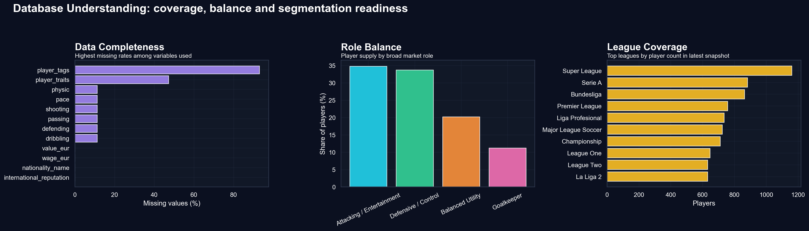

这张图先回答一个基础问题：我们的数据能否支撑营销分析。

数据中包含球员年龄、位置、联赛、能力值、潜力、市场价值、工资、国际声望、技术动作、俱乐部声望等变量。清洗后球员样本约 **18,031 人**，实际付费转会样本约 **1,326 笔**。

从营销角度看，数据不是只有“球员表现”，而是同时包含了市场细分需要的几个关键维度：

- 年龄可以对应产品生命周期。
- 位置可以对应产品类别。
- 联赛可以对应品牌语境。
- 技术能力和声望可以对应产品属性和传播价值。

这说明我们可以把球员市场视为一个可细分、可定位、可解释的差异化产品市场。

> **本页 takeaway：** 球员市场具备清晰的细分结构，适合用 STP 框架进行营销分析。

---

## 3. 价格分布：足球转会市场是明星经济

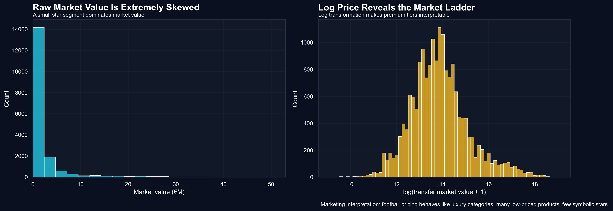

这张图展示了市场价值的原始分布和 log 转换后的分布。

可以看到，球员价格高度右偏。大多数球员集中在较低价格区间，少数顶级球员占据极高价值。样本中位数市场价值约 **100 万欧元**，但头部球员可以达到上亿欧元。球员市场价值的偏度约 **7.73**，实际转会费偏度约 **4.68**。

这意味着转会市场不是一个均匀市场，而是典型的 **明星经济**。少数球员因为稀缺性、品牌价值、竞技影响力和商业传播能力，获得远高于平均水平的估值。

在营销理论中，这类似奢侈品或高端娱乐产品市场：价格不仅反映功能价值，也反映象征价值和关注度价值。

> **本页 takeaway：** 足球转会定价不是普通劳动力市场，而是头部明星驱动的溢价市场。

---

## 4. 成长定位：年轻球员为什么贵？

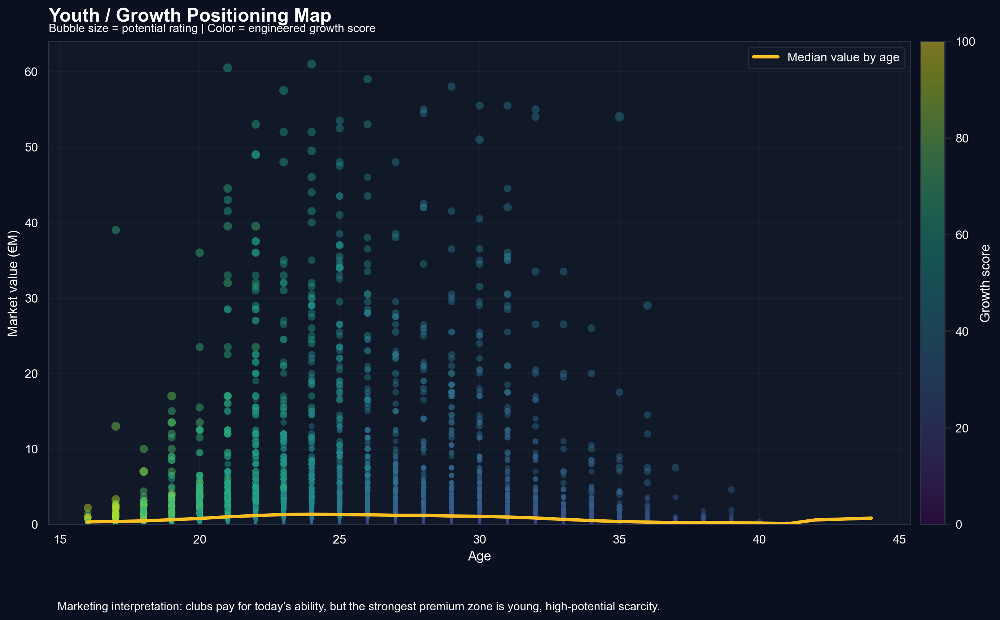

这张图把年龄、市场价值、潜力和成长分数放在同一张图中。

高价年轻球员非常明显，例如 K. Mbappé、E. Haaland、P. Foden、Vinícius Jr. 等。他们共同处在年轻、高潜力、高价值区域。

营销上，这说明俱乐部购买年轻球员时，并不只是购买当前表现，而是在购买未来选择权：

- 未来能力提升空间。
- 长期合同下的资产控制。
- 转售可能性。
- 与俱乐部品牌共同成长的故事。

这可以用 **产品生命周期理论** 解释。年轻球员处于增长期，市场价格中包含未来成长预期；成熟球员虽然能力稳定，但上升空间有限；老将则逐渐进入衰退期。

因此，“年轻”本身不是价格来源，真正被定价的是年轻背后的 **growth option**。

> **本页 takeaway：** 市场系统性奖励未来上升空间，年轻高潜力球员是典型增长型资产。

---

## 5. 品牌定位：联赛是一种市场背书

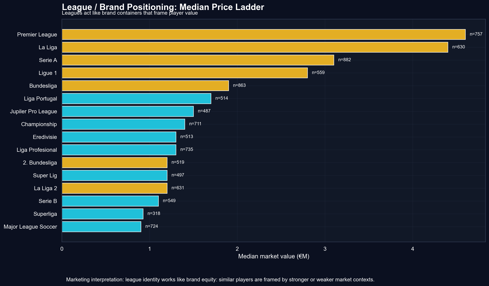

这张图展示不同联赛球员的中位数市场价值。

结果显示，Premier League、La Liga、Serie A、Ligue 1、Bundesliga 等顶级联赛明显处于价格阶梯前列。例如 Premier League 的中位数约 **460 万欧元**，La Liga 约 **440 万欧元**，明显高于许多非五大联赛。

这说明联赛不是中性的比赛场景，而是球员产品的品牌包装。

从品牌资产理论看，顶级联赛为球员提供三种价值：

- **质量背书**：高水平联赛降低买方的不确定性。
- **曝光背书**：更多媒体和观众提升球员可见度。
- **交易背书**：成熟市场提高球员未来流动性。

这类似营销中的 **country-of-origin effect**：消费者会根据产品来源地形成质量判断。球员来自哪个联赛，会影响俱乐部对其质量、风险和市场吸引力的判断。

> **本页 takeaway：** 联赛身份类似品牌资产，会显著影响球员的市场定价。

---

## 6. 注意力定位：为什么进攻型球员更容易溢价？

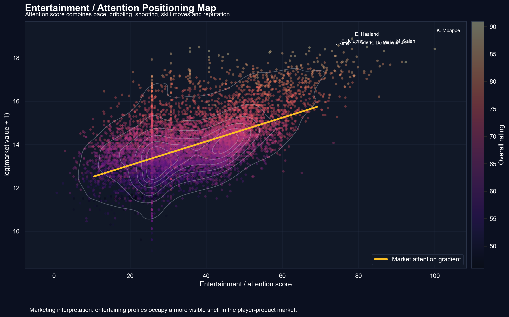

这张图使用注意力分数衡量球员的娱乐性和传播潜力。注意力分数由速度、盘带、射门、技术动作和国际声望组合而成。

从图中可以看到，注意力分数较高的球员往往集中在更高价格区域。K. Mbappé、M. Salah、Vinícius Jr. 等球员不仅是竞技资产，也是高传播价值资产。

营销上，这对应 **注意力经济**。现代足球俱乐部不仅需要赢球，也需要吸引观众、制造话题、增强社交媒体传播和提升商业合作价值。

进攻型球员更容易获得溢价，是因为他们的表现更直观：

- 进球和助攻容易被记忆。
- 速度和盘带容易形成高光片段。
- 前锋和边锋更容易成为球迷消费的对象。
- 明星攻击手更容易带动球衣、赞助和全球传播。

因此，注意力型球员的价格中包含一种额外的 **promotion value**。

> **本页 takeaway：** 娱乐型球员获得的不只是竞技价格，还有注意力溢价。

---

## 7. PCA 原型图：市场购买的是球员原型

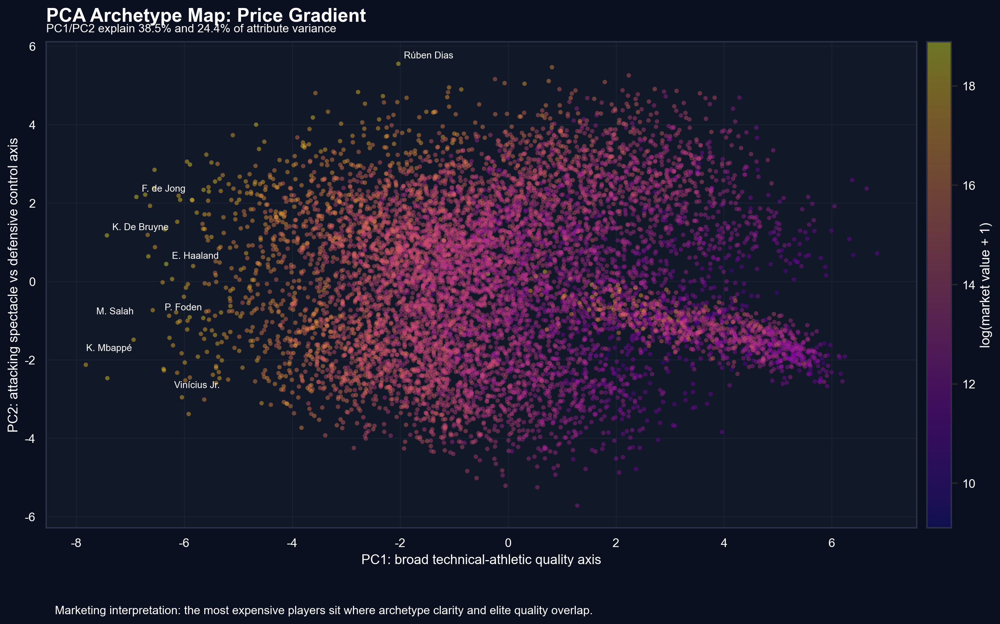

PCA 将速度、射门、传球、盘带、防守、身体等多维属性压缩到二维空间。

这里的重点不是数学本身，而是把球员从一堆属性转化为可解释的“市场原型”。前两个主成分合计解释约 **62.9%** 的属性结构，说明球员能力可以被压缩成几个有意义的定位方向。

从营销上看，这张图类似 **perceptual map 感知地图**。消费者不会逐项计算产品参数，而是形成整体印象。俱乐部看球员也是如此：某个球员是爆破型边锋、组织型中场、防守型中卫，还是全能型核心。

高价球员往往不只是某一项属性强，而是拥有清晰且稀缺的市场原型。

> **本页 takeaway：** 俱乐部购买的不是孤立属性，而是可识别、可定位的球员原型。

---

## 8. PCA 分组图：产品类别与品牌语境共同塑造价值

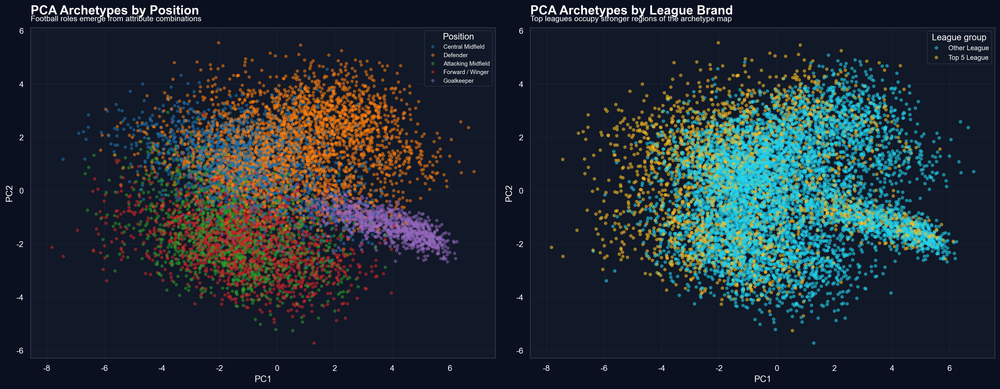

这张图使用同一 PCA 空间，分别按位置和联赛类型上色。

左侧图说明，不同位置的球员在能力空间中形成明显区域。前锋、中场、后卫、门将不是同一产品类别，而是完全不同的产品线。

右侧图说明，顶级联赛球员更集中在高质量、更成熟的原型区域。联赛身份在这里起到品牌语境作用。

因此，球员定价由两层结构共同决定：

- **产品类别**：球员踢什么位置，解决什么竞技问题。
- **品牌语境**：球员来自什么联赛，市场如何理解他的质量。

这正好对应 STP 中的 segmentation 和 positioning。位置完成基本细分，联赛强化市场定位。

> **本页 takeaway：** 球员价格由产品类别和品牌语境共同塑造。

---

## 9. t-SNE 身份地图：市场不是所有球员互相竞争

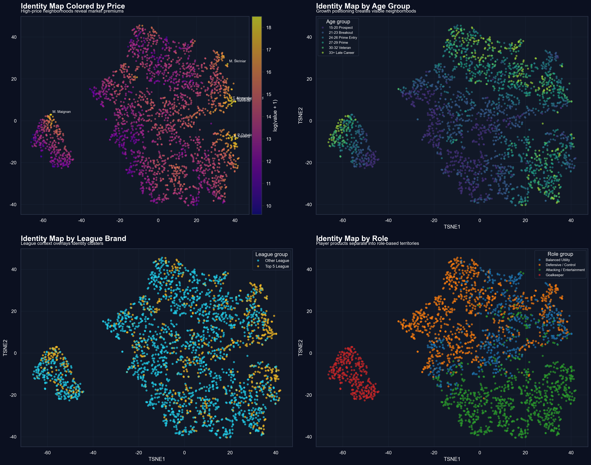

t-SNE 将球员按多维属性相似性组织成二维身份地图，并分别用价格、年龄组、联赛和角色上色。

这张图的重要意义在于，它告诉我们：市场竞争不是“所有球员和所有球员竞争”。真实竞争发生在相似球员身份之间。

例如：

- 年轻攻击手之间形成一个比较集合。
- 成熟组织型中场之间形成一个比较集合。
- 防守控制型球员之间形成另一个比较集合。
- 顶级联赛球员在部分区域形成更强的品牌聚集。

营销理论中，这接近 **consideration set**。买方不会在全部产品中随机选择，而是先确定需求，再在一个相似定位的备选集合中比较。

对俱乐部来说，先有目标定位，再有候选球员池。价格就是在这个候选池中被推高或压低的。

> **本页 takeaway：** 市场不是定价单个属性，而是在定价可识别的球员身份邻域。

---

## 10. 综合定位图：成长、品牌、注意力如何共同影响价格

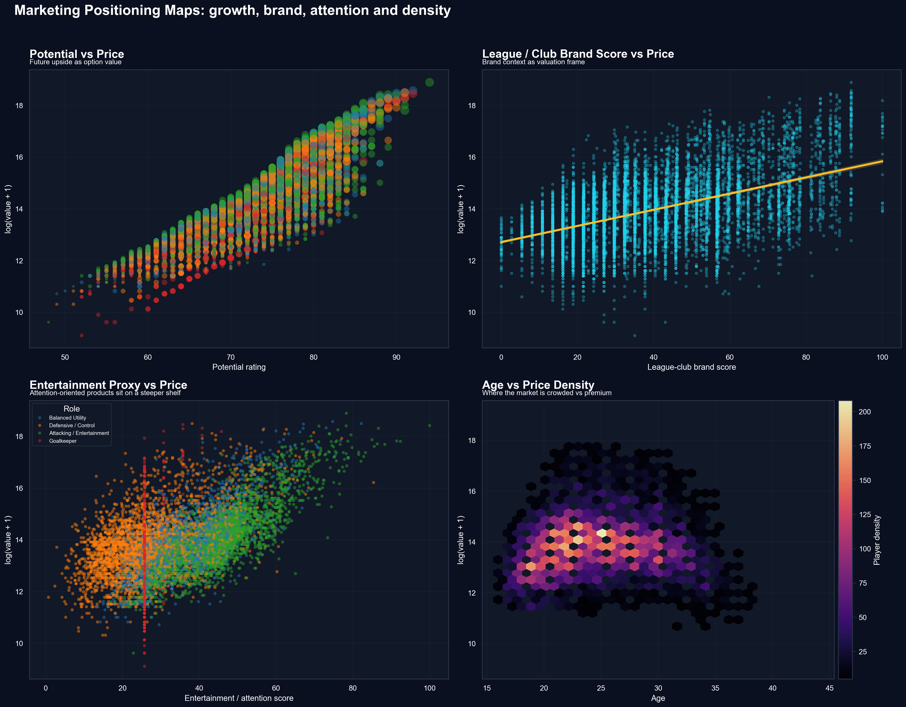

这张图是本汇报的战略总图。它同时展示了四个定位关系：

- 潜力 vs 价格。
- 品牌分数 vs 价格。
- 注意力分数 vs 价格。
- 年龄 vs 价格密度。

四个子图共同说明：价格不是由一个因素决定，而是由多种定位维度共同塑造。

从 STP 角度看，俱乐部首先识别市场细分，然后选择符合自身战略的目标细分，最后通过支付价格完成定位。例如：

- 重建型俱乐部可能更重视年轻潜力。
- 豪门俱乐部可能更重视即战力和顶级品牌匹配。
- 商业化强的俱乐部可能更重视注意力和全球传播。

因此，转会费是多个定位维度叠加后的市场结果。

> **本页 takeaway：** 转会价格是成长、品牌和注意力三种定位价值的综合信号。

---

## 11. 市场细分：球员市场可以像产品组合一样管理

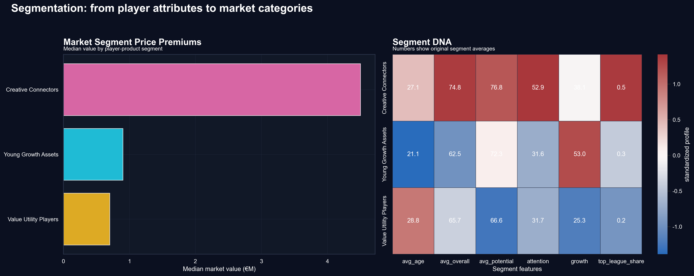

这张图通过聚类将球员划分为不同市场细分，并展示各细分的价格水平和特征。

当前模型识别出几类有营销意义的球员资产：

- **Creative Connectors**：创造型连接者，中位数价值较高，约 **450 万欧元**。
- **Young Growth Assets**：年轻成长资产，数量多，成长属性强。
- **Value Utility Players**：实用型补充球员，价格较低但供给充足。

营销上，这相当于把球员市场做成一个产品组合矩阵。不同细分有不同价值主张：

- 创造型球员提供组织和进攻连接能力。
- 年轻成长资产提供未来价值和转售空间。
- 实用型球员提供成本效率和阵容深度。

这也解释了为什么不同俱乐部会有不同引援策略。预算充足的俱乐部追逐高溢价细分，预算有限的俱乐部则寻找性价比细分。

> **本页 takeaway：** 球员市场不是统一市场，而是多个具有不同价格逻辑的市场细分。

---

## 12. 隐含价格溢价：把营销假设转化为价格语言

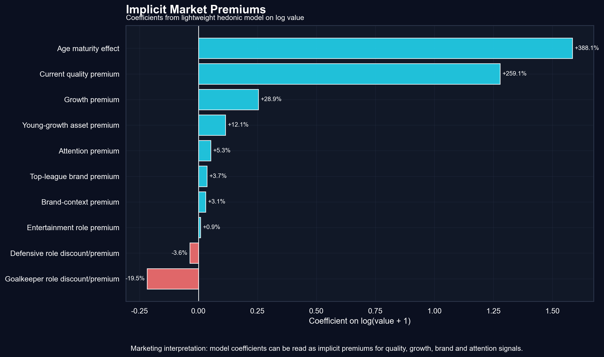

这张图来自轻量 hedonic pricing model。它不是为了追求预测精度，而是为了回答：市场到底为哪些属性支付溢价？

模型结果显示：

- overall 对价格影响非常强，说明当前能力仍是基础。
- potential gap 对应约 **28.9%** 的成长溢价。
- young-growth asset 对应约 **12.1%** 的额外溢价。
- top league 和 club brand score 也呈现正向品牌溢价。
- attention score 有正向溢价，说明注意力属性确实进入价格结构。

从营销角度看，这张图把前面的叙事转化为价格语言。我们不只是说年轻球员更贵、顶级联赛更贵、进攻球员更有价值，而是进一步说明市场愿意为这些定位支付额外价格。

这对应 **hedonic pricing** 思想：一个产品的价格可以拆解为多个属性价值之和。

> **本页 takeaway：** 俱乐部实际在为质量、成长、品牌和注意力支付溢价。

---

## 13. 实际交易热力图：真实支付是否支持定位逻辑？

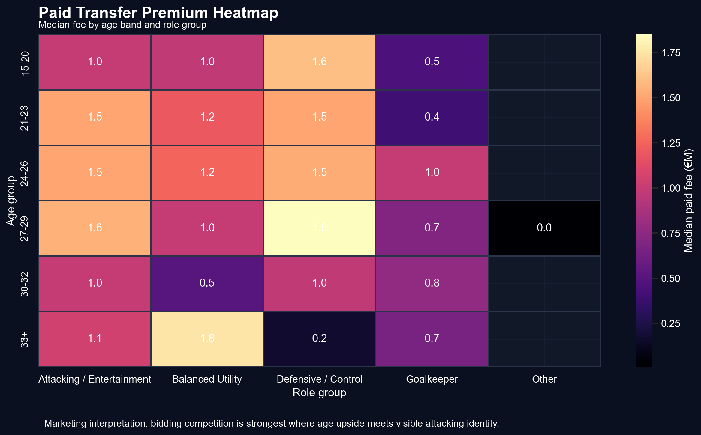

前面的图主要基于球员市场价值。这张图使用实际付费转会数据，看不同年龄段和角色组合下的真实转会费中位数。

它的价值在于把估值逻辑落到真实交易行为上。市场价值可以理解为估计价格，而真实转会费更接近俱乐部实际支付意愿。

如果年轻或黄金年龄段的进攻球员在热力图中呈现更高价格，就说明成长价值和注意力价值不仅存在于估值中，也体现在俱乐部真实付费行为中。

从营销上看，这一步相当于用购买行为验证消费者偏好。俱乐部不是口头上喜欢某类球员，而是在实际交易中用更高价格表达偏好。

> **本页 takeaway：** 真实转会费验证了年龄和角色组合对市场支付意愿的影响。

---

## 14. 综合结论：俱乐部到底在为什么付钱？

通过以上分析，可以把足球转会定价理解为四层价格结构：

第一层是 **能力价格**。overall 越高，球员越接近即战力，基础价格越高。

第二层是 **成长价格**。年轻、高潜力、有潜力差的球员被市场赋予未来价值。

第三层是 **品牌价格**。顶级联赛和强俱乐部背景提供质量背书和曝光价值。

第四层是 **注意力价格**。速度、盘带、射门和明星声望让球员具备传播价值。

因此，俱乐部通过转会支出揭示的偏好并不是单一的“谁更强”，而是：

- 谁更有成长性。
- 谁更符合品牌语境。
- 谁更能吸引注意力。
- 谁在稀缺细分中更难替代。

最终结论可以概括为：

> **足球俱乐部不是简单购买球员能力，而是在不确定性中购买成长空间、品牌背书和注意力资产。转会价格就是这些市场偏好的综合信号。**

---

## 15. 课程汇报收束页

如果用一句营销语言总结本项目：

> **Transfer spending is market positioning in action.**  
> 转会支出就是市场定位的实际行动。

本分析对营销课程的意义在于，它把一个看似体育的数据集，转化为营销分析中的经典问题：

- 市场如何细分？
- 品牌如何影响价格？
- 产品属性如何形成溢价？
- 注意力如何转化为商业价值？
- 消费者，也就是俱乐部，如何通过支付行为表达偏好？

这也说明，营销分析不只适用于消费品、广告或电商。只要存在差异化产品、价格信号和购买决策，营销框架就可以帮助我们理解市场行为。

---

## HTML 汇报制作建议

建议将本文档拆成 12 到 15 个页面或 section：

1. 标题与研究问题。
2. 理论框架。
3. 数据基础。
4. 价格偏态。
5. 成长定位。
6. 品牌定位。
7. 注意力定位。
8. PCA 原型。
9. t-SNE 身份地图。
10. 综合定位图。
11. 市场细分。
12. 价格溢价模型。
13. 实际交易热力图。
14. 总结结论。

页面风格建议：

- 保持深色背景，与图片视觉一致。
- 每页只保留一个核心 takeaway。
- 图表下方放 1 到 2 句营销解释，不堆统计细节。
- 重点讲“价格揭示偏好”，不要把汇报讲成机器学习模型展示。
